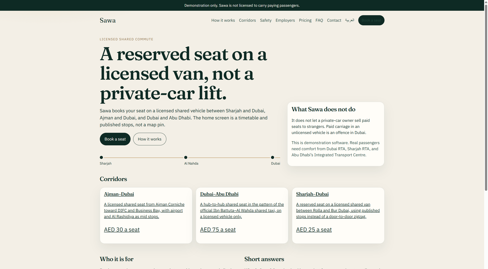
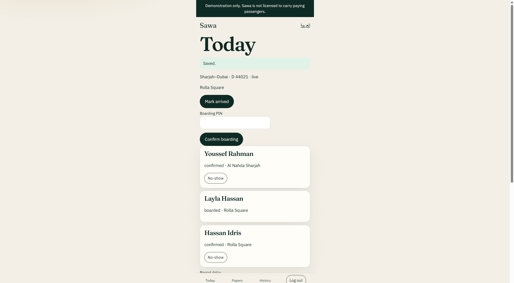

# Sawa

Sawa books a reserved seat on a licensed shared vehicle for UAE commute corridors. It is a demonstration of the product in the November 2026 planning brief: Sharjah–Dubai, Ajman–Dubai, and Dubai–Abu Dhabi.

It is not a marketplace where a private-car owner charges strangers for a lift. The database has no supply type for a private car. Running this repository does not authorize passenger transport. A live service still needs written comfort from Dubai RTA, Abu Dhabi’s Integrated Transport Centre, and Sharjah RTA, plus a licensed operator.

## Screens







## Run it

```bash
npm install
npx prisma db push
npm run db:seed
npm run dev
```

Open http://127.0.0.1:3000/en

The dev server listens on all interfaces. On a phone paired with wireless ADB:

```bash
adb reverse tcp:3000 tcp:3000
adb shell am start -a android.intent.action.VIEW -d http://127.0.0.1:3000/en
```

## Demo accounts

| Who | Sign in | Code |
| --- | --- | --- |
| Rider Layla Hassan | +971 50 100 0001 at /en/ride/login | 123456 |
| Driver Omar Al Hashimi | +971 50 100 0002 at /en/drive/login | 123456 |
| Staff owner | ops@sawa.test at /en/ops/login | sawa-demo |
| Finance | finance@sawa.test | sawa-demo |

Other seeded drivers: Fatima (+971 50 100 0003, ladies-licensed), Imran (documents incomplete), Sami (suspended, insurance expired).

Card checkout accepts only `4242 4242 4242 4242`. The app stores the last four digits and a fake processor reference. No SMS provider and no UAE acquirer are connected. The code `123456` is the stand-in for Unifonic or Twilio.

## What the first version includes

- Marketing site in English and Arabic (real right-to-left layout), with FAQ schema, sitemap, robots, Open Graph, and `/llms.txt`
- Rider flow: OTP, profile, corridor timetable, single seat or monthly pass, sandbox payment, boarding PIN, live trip, share link, SOS, tickets, cancellation rule, account deletion, large type
- Driver flow: enrolled login, document upload, shift start only when documents are valid, manifest, PIN boarding, no-show, delay, incident, background-location disclosure. The map draws the driving route from OpenStreetMap roads. A phone GPS fix on the corridor moves the van and the ETA. A fix far from the corridor is stored, and the van stays on the road instead of jumping across countries. “Move along the road” steps the van about 3 km along that driving route.
- Staff CRM: roles, enrollment, document review, planning board with hard filters and weighted scores, confirm or override with an audit reason, live runs, substitution, invoices, refunds, payouts, tickets, CSV import, CSV export, employer view, audit log

Matching hard-fails an unapproved driver, expired documents, a missing operator licence, a driver already on another corridor that shift, too few seats, a wheelchair need the vehicle cannot meet, a women-only request without a ladies-licensed driver, a ladies vehicle on a mixed group, and a driving detour over 12 minutes. Detour minutes come from the road route, not a fixed penalty. A second SOS on the same trip reuses the open alert. Weights: distance 20, detour 20, overlap 15, seat fit 15, schedule 15, rating 5, vehicle 5, women-only fit 5.

## Store readiness

This build is not submitted to Google Play or the App Store. When a UAE entity is ready:

- Privacy policy and terms are real URLs: `/en/privacy` and `/en/terms`, linked inside the app.
- Account deletion is in rider settings, not email-only.
- Background location copy is on the driver home screen and says location continues during a shift.
- Ride fares are real-world transport. Do not put them through Apple In-App Purchase (Guideline 3.1.3(e)).
- Reviewers need the demo rider, driver, and staff accounts above, plus a note that the fleet in the database is fictional.

## Production path

Keep the Prisma schema. Move `DATABASE_URL` to Postgres with PostGIS in AWS `me-central-1` or Azure UAE. Swap the demo OTP for a UAE sender ID, and the test card for a local acquirer (Checkout.com, Network International, Telr, or PayTabs — confirm onboarding). Replace the haversine adapter with Google Routes or a self-hosted OSRM/Valhalla instance before promising peak ETAs on E11 and E311. UAE Pass stays a later identity link; do not block the product on it.

## Now in this build

- Shared rides on the same road, day, and time join one open van of 4. The listed seat price falls as seats fill, until someone agrees a price.
- A passenger can share a referral code. Both wallets receive AED 20 when the new passenger's first ride is confirmed.
- The wallet stores that balance. Adding money uses the test card `4242…`. A confirmed fare can be paid from the balance.
- Two passengers on the same van can split one fare. The other person accepts or declines.
- Call stays inside the ride. Phone numbers are not shown. Both people need the ride open, and a microphone. This is not a carrier masked-number service.
- Staff can prepare a WhatsApp message for passengers who opted in. Each send opens WhatsApp. It is not marked delivered.
- `sawa-store.apk` is a separate Android application id (`dev.sawa.store`) so it installs beside the test app. It is not listed on Google Play.

## Licence

All rights reserved. Demonstration software. Not legal advice.
