<p align="center">
  <a href="https://sawa.induswebagency.com"></a>
</p>

<h1 align="center">Sawa</h1>

<p align="center">
  <strong>سوى</strong> · a reserved seat on a shared commute van<br>
  Sharjah–Dubai · Ajman–Dubai · Dubai–Abu Dhabi
</p>

<p align="center">
  <a href="https://sawa.induswebagency.com"></a>
  <a href="https://sawa.induswebagency.com/en"></a>
  <a href="https://sawa.induswebagency.com/ar"></a>
  <a href="https://sawa.induswebagency.com/sawa.apk"></a>
  <a href="https://sawa.induswebagency.com/llms.txt"></a>
</p>

<p align="center">
  
  
  
  
  
  
  
</p>

Sawa is a demonstration of reserved-seat shared commute on three UAE corridors. A passenger books a seat. Staff enroll the driver. A person confirms the van.

It is not a marketplace where a private-car owner charges strangers for a lift. The database has no supply type for a private car. Running this repository does not authorize passenger transport. A live service still needs written comfort from Dubai RTA, Abu Dhabi’s Integrated Transport Centre, and Sharjah RTA, plus a licensed operator.

## Links

| | |
| --- | --- |
| Site | https://sawa.induswebagency.com |
| English | https://sawa.induswebagency.com/en |
| Arabic | https://sawa.induswebagency.com/ar |
| FAQ | https://sawa.induswebagency.com/en/faq |
| Safety | https://sawa.induswebagency.com/en/safety |
| Pricing | https://sawa.induswebagency.com/en/pricing |
| Privacy | https://sawa.induswebagency.com/en/privacy |
| Terms | https://sawa.induswebagency.com/en/terms |
| Sitemap | https://sawa.induswebagency.com/sitemap.xml |
| Citation file | https://sawa.induswebagency.com/llms.txt |
| Test Android app | https://sawa.induswebagency.com/sawa.apk |
| Store build, not on Google Play | https://sawa.induswebagency.com/sawa-store.apk |
| Source | https://github.com/mafzalkalwardev/sawa |

## Stack

| Layer | What it uses |
| --- | --- |
| Web | Next.js 15, React 19, TypeScript |
| Data | Prisma 6, SQLite for the demo |
| Maps | Leaflet on the OpenStreetMap road network |
| Phone | Android WebView. `dev.sawa.app` is the test app. `dev.sawa.store` installs beside it and is not on Google Play |
| Languages | English, and Arabic with a real right-to-left layout |
| Public site | https://sawa.induswebagency.com |

## Screens

<table>
  <tr>
    <td width="50%" align="center"><br><sub>English home</sub></td>
    <td width="50%" align="center">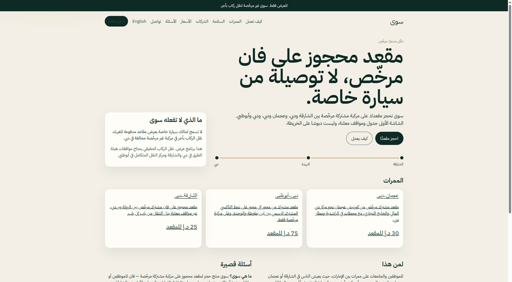<br><sub>Arabic home</sub></td>
  </tr>
  <tr>
    <td width="50%" align="center">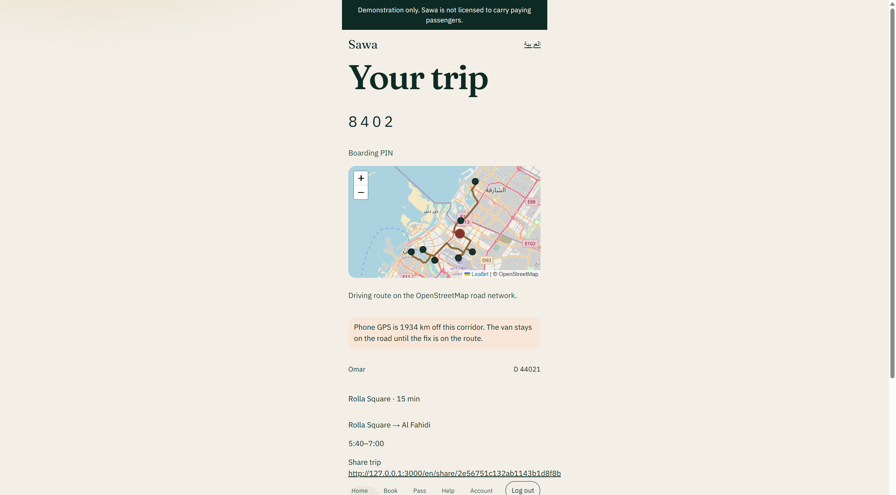<br><sub>Live trip</sub></td>
    <td width="50%" align="center"><br><sub>Driver shift</sub></td>
  </tr>
  <tr>
    <td width="50%" align="center">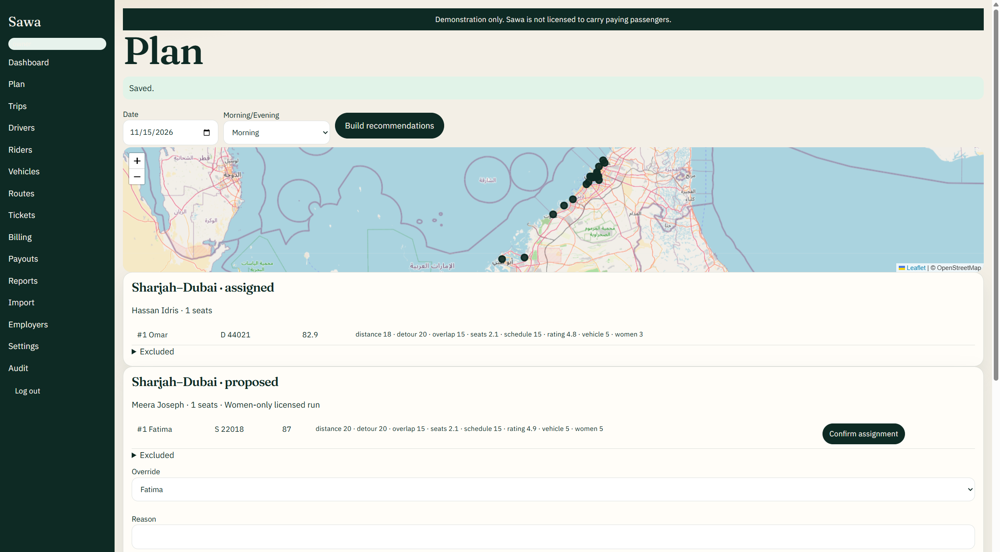<br><sub>Staff planning board</sub></td>
    <td width="50%" align="center">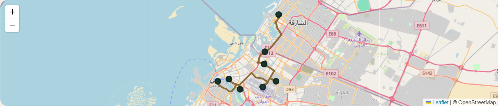<br><sub>Sharjah–Dubai on the road network</sub></td>
  </tr>
</table>

## Features

### Passenger

- Separate sign-up and sign-in. The phone number is the account. The demo code is `123456`. No SMS provider is connected.
- Profile photo and identity document before a seat can be requested.
- Book a corridor, a morning or evening window, a pickup stop, and a drop-off.
- One day, or the same road every working day. A monthly ride can be paused.
- Share the van, or take it alone. A women-only preference is stored with the request.
- The quote is the seat price plus a share of the road toll. Sharjah–Dubai shared is 100 AED before toll.
- Shared requests on the same road, day, shift, window, and product join one van of 4. The listed price falls as seats fill, until someone agrees a price. A full van puts the next passenger on a waitlist, and an early cancellation gives them the seat. Private rides do not pool.
- Optional referral code. Both wallets receive AED 20 when the new passenger’s first non-cancelled booking is created.
- Wallet top-up of 20, 50, or 100 AED, only when the card starts with `4242 4242 4242 4242`. A confirmed fare can be paid from the balance. The last four digits are stored. No UAE acquirer is connected.
- Two passengers on the same van can offer a split. The other person accepts or declines. At least 1 AED stays on the original booking.
- The passenger and the driver agree a price, then the driver confirms the seat.
- Chat on the request. The ride page opens a second thread after confirm.
- Pickup number, live map, and boarding when the driver enters that number.
- In-app call. Phone numbers stay hidden. Both people need the ride open and a microphone. There is no TURN server, so some networks fail after answer. This is not a carrier masked-number service.
- Share link for the trip. SOS alerts Sawa operations. It is not a public emergency service. Police 999, Dubai Police 901, ambulance 998.
- Rating after the boarded seat is marked dropped off.
- Updates inside the app when a price is sent, the ride is confirmed, a message arrives, the van reaches the stop, the passenger boards, or the passenger is dropped off. No text message is sent. The Android app shows a phone alert for a new update while Sawa is open. A browser can do the same after permission.
- A finished ride shows a receipt: the fare, any wallet portion, the driver, and the plate.
- Help, tickets, large type, language, and account deletion in settings. More than 2 hours before the shift, the passenger can cancel the request or the confirmed seat, or change the pickup and drop. A stop change adds or removes the toll share. The wallet amount comes back on an early cancel, and any wallet amount above a lower fare comes back too. A card charge stays a demo credit note, not a bank refund. Inside 2 hours the seat and the stops stay with the driver.
- Optional WhatsApp opt-in. Staff cannot message a passenger who has not asked.

### Driver

- Separate sign-up from the passenger. One phone cannot be both.
- Document and insurance upload. A shift starts only when the papers are valid.
- Queue of waiting requests. Accepting one queued request in an open van accepts the whole van and opens a chat per request.
- Agree the price, message the passenger, and confirm the ride onto today’s van.
- Today’s van: next stop, pickup number, boarding, no-show, running late, and an incident report to operations.
- Call a passenger from the van without showing the number.
- “Everyone is dropped off” completes boarded seats and ends the shift.
- History of finished runs.
- The map uses the OpenStreetMap road network. A GPS fix on the corridor moves the van and the ETA. A fix far from the corridor is stored, and the van stays on the road. “Move along the road” steps the van about 3 km along that route.
- Background-location copy on the driver home says location continues during a shift.

### Staff

- Roles. The demo owner is `ops@sawa.test` / `sawa-demo`. Finance uses the same password.
- Driver enrollment and document review.
- Planning board with hard filters and weighted scores. A person confirms or overrides with an audit reason.
- Live runs and substitution.
- Invoices, refunds, and payouts.
- Tickets, CSV import, CSV export, employer view, and an audit log.
- WhatsApp campaigns only for passengers who opted in. Each send opens `wa.me`. The status is waiting or opened. It is never marked delivered.

Matching hard-fails an unapproved driver, expired documents, a missing operator licence, a driver already on another corridor that shift, too few seats, a wheelchair need the vehicle cannot meet, a women-only request without a ladies-licensed driver, a ladies vehicle on a mixed group, and a driving detour over 12 minutes. Detour minutes come from the road route, not a fixed penalty. A second SOS on the same trip reuses the open alert. Weights: distance 20, detour 20, overlap 15, seat fit 15, schedule 15, rating 5, vehicle 5, women-only fit 5.

### Apps

- The public site is a phone-shaped web app with a manifest.
- `sawa.apk` is the sideload app, application id `dev.sawa.app`.
- `sawa-store.apk` is a separate application id, `dev.sawa.store`, so it installs beside the test app. It is not listed on Google Play.
- The microphone permission is granted only for `https://sawa.induswebagency.com`.

### SEO

Search pages are the public marketing site. Ride, driver, and staff URLs are `noindex`, and `robots.txt` disallows `/ride`, `/drive`, `/ops`, and `/api`.

- Each public page sets its own title and description, a canonical URL, and `hreflang` for English, Arabic, and `x-default`.
- Open Graph title, description, and locale (`en_AE` or `ar_AE`).
- `sitemap.xml` lists both languages, the marketing pages, and each corridor.
- Organization JSON-LD on the home page, with `areaServed` set to `AE`.
- FAQPage JSON-LD on the FAQ.
- Web app manifest, theme color `#0E2A24`, and `google: notranslate` so the Arabic layout is not auto-translated over.

### AEO

Answer engines need a short, quotable reply. The public pages are written that way.

- The FAQ heading is “Short answers.” Each question is an open `<details>` block and the same text is in FAQPage schema.
- The home description names the three corridors and says this is not a private-car marketplace.
- Safety, pricing, privacy, and terms each have a stable URL and a page description.
- `/llms.txt` is a plain-text card: what Sawa is, what it is not, the demo code and test card, the emergency numbers, and which pages are worth citing.
- The SOS copy names 999, 901, and 998, and says the button alerts operations.

### GEO

Generative engines quote a page when the entity, the boundary, and the URL stay stable.

- The name, the three corridors, and the private-car boundary are repeated on the home page, the FAQ, and `/llms.txt`.
- English and Arabic expose the same facts, so a generated answer can cite either language.
- `/llms.txt` tells a model which URLs to cite and which claims not to invent: no SMS provider, no live acquirer, demo fares, and no authorization to carry passengers.
- Corridor pages are their own URLs under `/corridors/sharjah-dubai`, `/corridors/ajman-dubai`, and `/corridors/dubai-abu-dhabi`.
- Ride, driver, staff, and share links stay out of the index so a model is not pointed at a private trip.

## Run it

```bash
npm install
npx prisma db push
npm run db:seed
npm run dev
```

Open http://127.0.0.1:3000/en

The dev server listens on all interfaces. On a phone paired with wireless ADB:

```bash
adb reverse tcp:3000 tcp:3000
adb shell am start -a android.intent.action.VIEW -d http://127.0.0.1:3000/en
```

## Demo accounts

| Who | Sign in | Code |
| --- | --- | --- |
| Rider Layla Hassan | +971 50 100 0001 at /en/ride/login | 123456 |
| Driver Omar Al Hashimi | +971 50 100 0002 at /en/drive/login | 123456 |
| Staff owner | ops@sawa.test at /en/ops/login | sawa-demo |
| Finance | finance@sawa.test | sawa-demo |

Other seeded drivers: Fatima (+971 50 100 0003, ladies-licensed), Imran (documents incomplete), Sami (suspended, insurance expired).

Card checkout accepts only `4242 4242 4242 4242`. The app stores the last four digits and a fake processor reference. No SMS provider and no UAE acquirer are connected. The code `123456` is the stand-in for Unifonic or Twilio.

## Store readiness

This build is not submitted to Google Play or the App Store. When a UAE entity is ready:

- Privacy policy and terms are real URLs: `/en/privacy` and `/en/terms`, linked inside the app.
- Account deletion is in rider settings, not email-only.
- Background location copy is on the driver home screen and says location continues during a shift.
- Ride fares are real-world transport. Do not put them through Apple In-App Purchase (Guideline 3.1.3(e)).
- Reviewers need the demo rider, driver, and staff accounts above, plus a note that the fleet in the database is fictional.

## Production path

Keep the Prisma schema. Move `DATABASE_URL` to Postgres with PostGIS in AWS `me-central-1` or Azure UAE. Swap the demo OTP for a UAE sender ID, and the test card for a local acquirer (Checkout.com, Network International, Telr, or PayTabs — confirm onboarding). Replace the haversine adapter with Google Routes or a self-hosted OSRM/Valhalla instance before promising peak ETAs on E11 and E311. UAE Pass stays a later identity link; do not block the product on it.

## Two phones, 16 November 2026

Infinix X697 signed in as the driver (Omar, Sharjah–Dubai, already on shift). Pixel 7a stayed the passenger and booked a shared seat: Rolla Square to Al Fahidi, morning 7:00–8:10, one day, 103 AED. Both phones ran the installed app against https://sawa.induswebagency.com. The full set of step frames is in `docs/walkthrough`. The queue frames that include the passenger’s uploaded profile photo are `15-infinix-queue.png` and `16-infinix-accept.png`. They are not embedded below.

The passenger asked for the seat. The open van showed 1 of 4, and the driver agreed 103 AED.

<table>
  <tr>
    <td width="33%" align="center">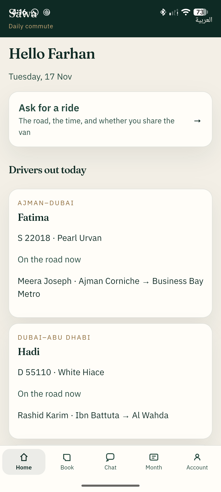<br><sub>Passenger home</sub></td>
    <td width="33%" align="center">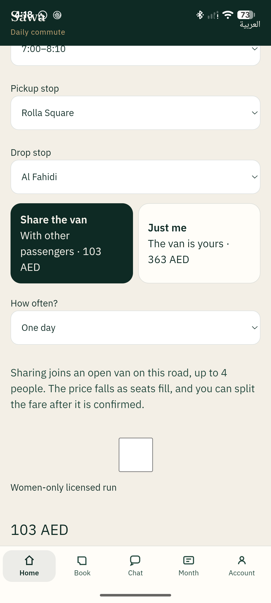<br><sub>103 AED to share the van</sub></td>
    <td width="33%" align="center">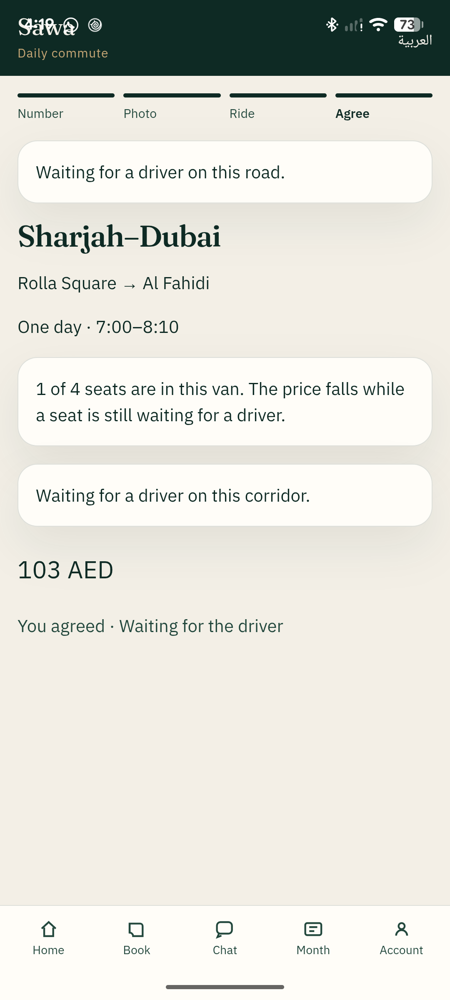<br><sub>Waiting, 1 of 4</sub></td>
  </tr>
  <tr>
    <td width="33%" align="center">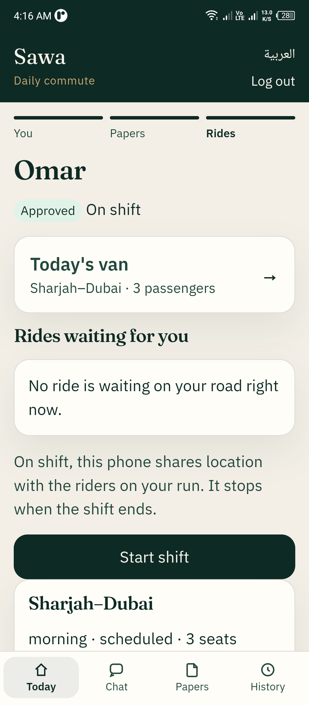<br><sub>Driver home</sub></td>
    <td width="33%" align="center">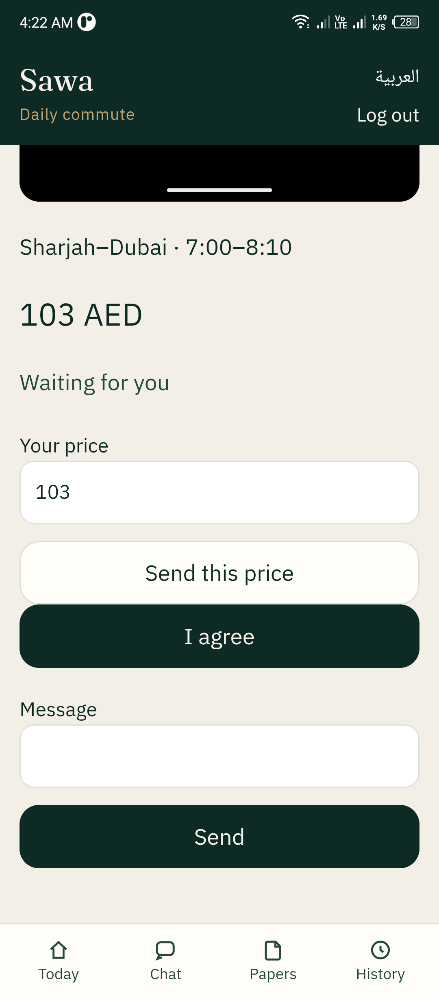<br><sub>Agrees 103 AED</sub></td>
    <td width="33%" align="center">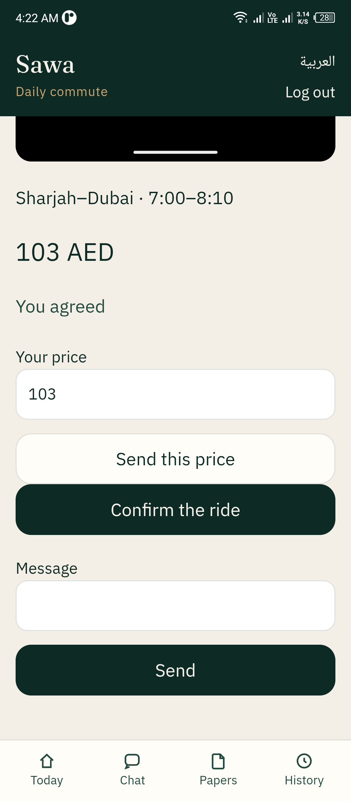<br><sub>Price agreed</sub></td>
  </tr>
</table>

The driver sent “On my way” and confirmed the seat. The passenger answered “See you at Rolla” on that same request. Those two lines stayed on the request. The ride chat opened after confirm is a different thread and was empty.

<table>
  <tr>
    <td width="33%" align="center">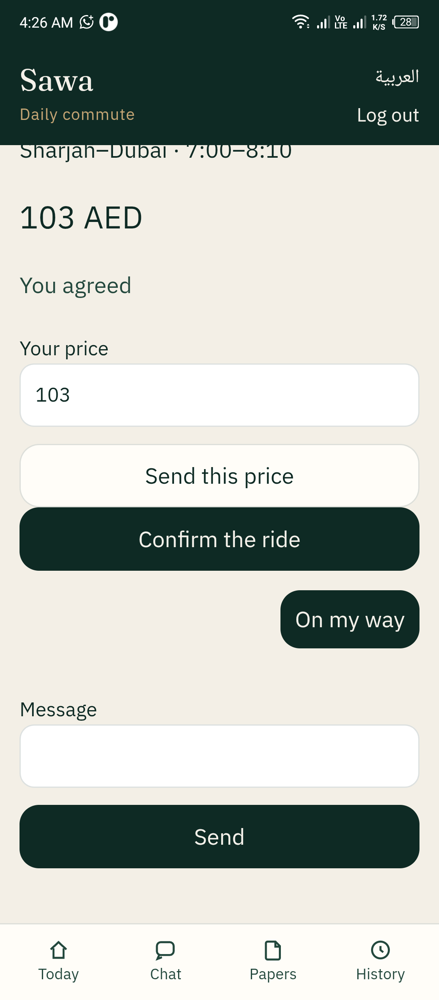<br><sub>Confirm, with the message</sub></td>
    <td width="33%" align="center">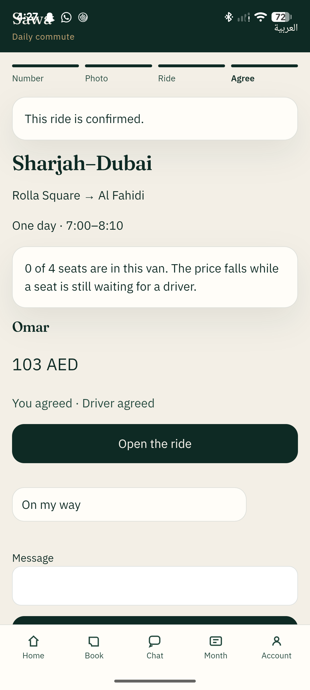<br><sub>Passenger sees it</sub></td>
    <td width="33%" align="center">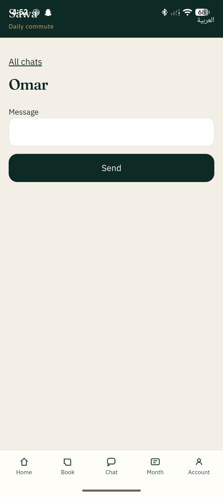<br><sub>Ride chat is empty</sub></td>
  </tr>
</table>

The home card showed pickup number 1643 and plate D 44021. The driver entered 1643 and the app recorded boarding. The phone was not on the corridor, so the van stayed on the mapped route.

<table>
  <tr>
    <td width="33%" align="center">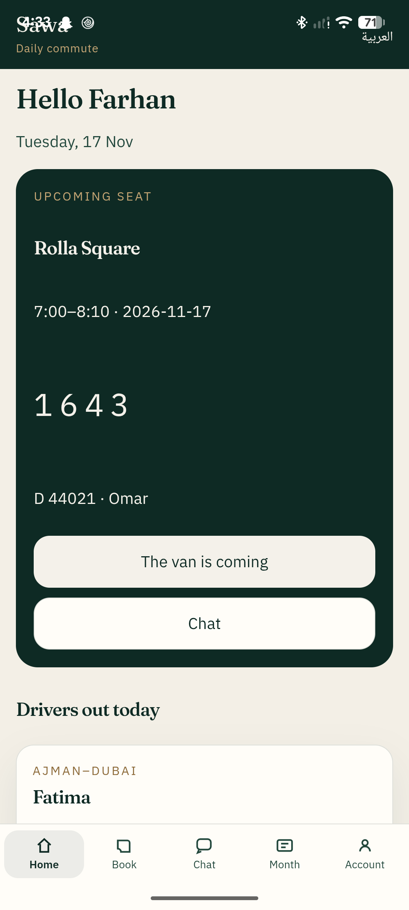<br><sub>Pickup number 1643</sub></td>
    <td width="33%" align="center">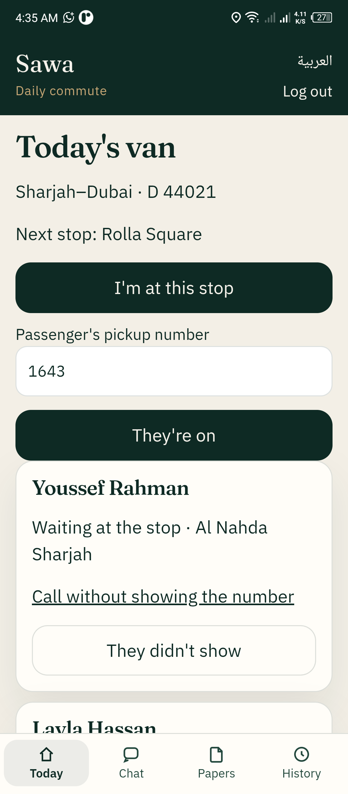<br><sub>Driver enters 1643</sub></td>
    <td width="33%" align="center">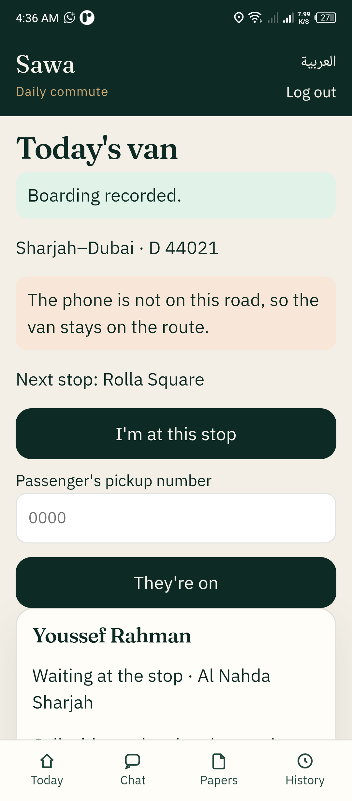<br><sub>Boarding recorded</sub></td>
  </tr>
</table>

Both phones opened the in-app call. No phone number was shown. Each side reached “The call is open.” When the driver hung up, his screen returned to Call, and the passenger stayed on “The call is open” until he hung up himself.

<table>
  <tr>
    <td width="33%" align="center">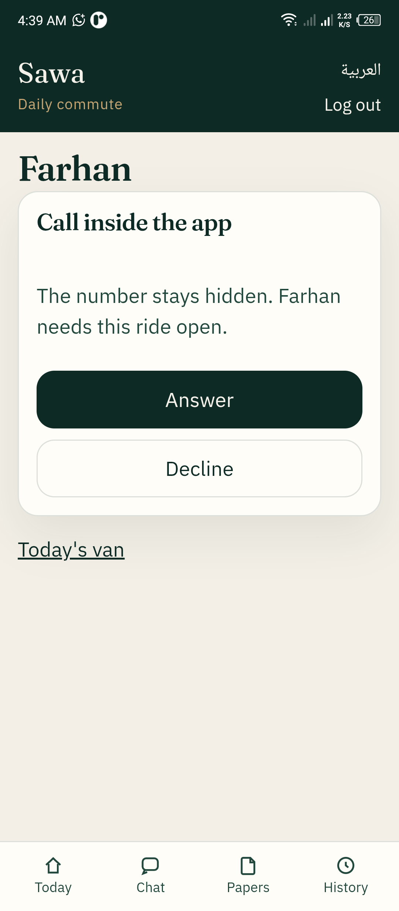<br><sub>Driver can answer</sub></td>
    <td width="33%" align="center">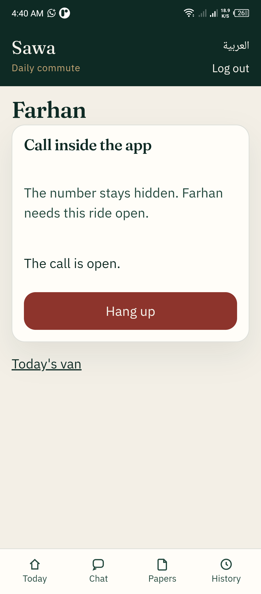<br><sub>Driver, call open</sub></td>
    <td width="33%" align="center"><br><sub>Passenger, call open</sub></td>
  </tr>
</table>

Paying 103 AED from the wallet failed honestly: the balance was 0. “Everyone is dropped off” finished the run and ended the shift. The other three seats on that van were still waiting. History then counted all four fares, including a 0 AED seat, as 303 AED. The passenger rated the ride 5 with the note “Smooth ride.”

<table>
  <tr>
    <td width="33%" align="center">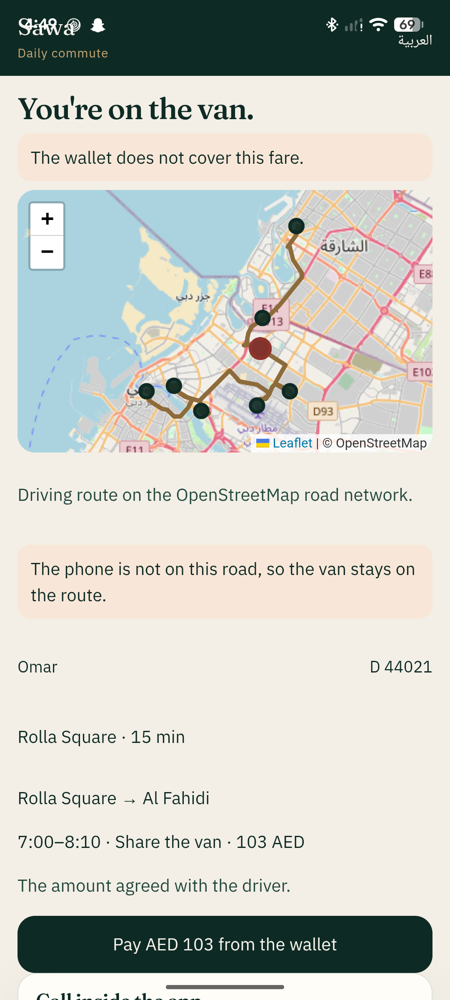<br><sub>Wallet does not cover 103</sub></td>
    <td width="33%" align="center">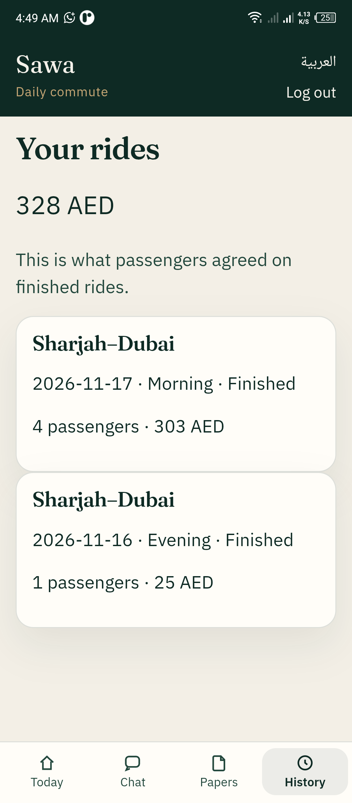<br><sub>Van marked finished</sub></td>
    <td width="33%" align="center">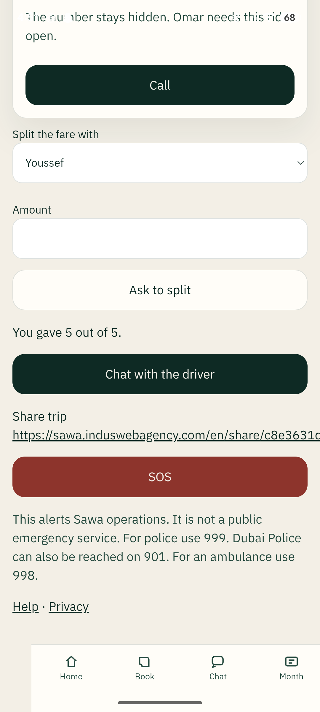<br><sub>Rated 5 out of 5</sub></td>
  </tr>
</table>

One load of the chat URL failed in the WebView with `net::ERR_NAME_NOT_RESOLVED`. Opening the app again reached the ride. The back key can also leave the app entirely. Hanging up cleared the driver and left the passenger on “The call is open.”

<table>
  <tr>
    <td width="33%" align="center">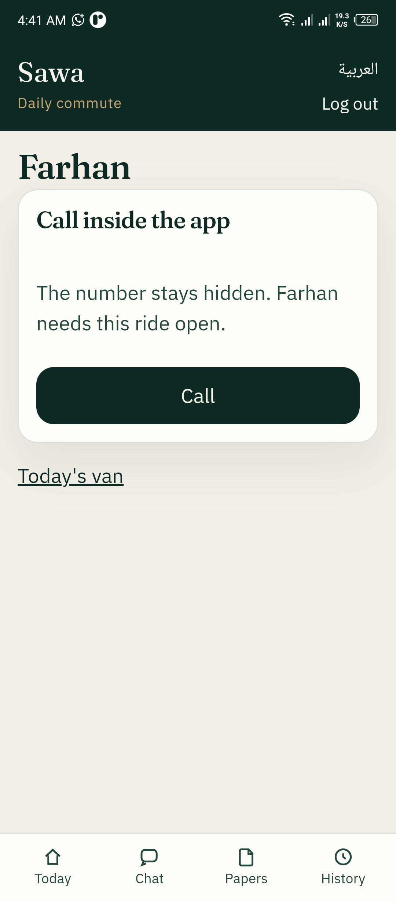<br><sub>Driver hung up</sub></td>
    <td width="33%" align="center">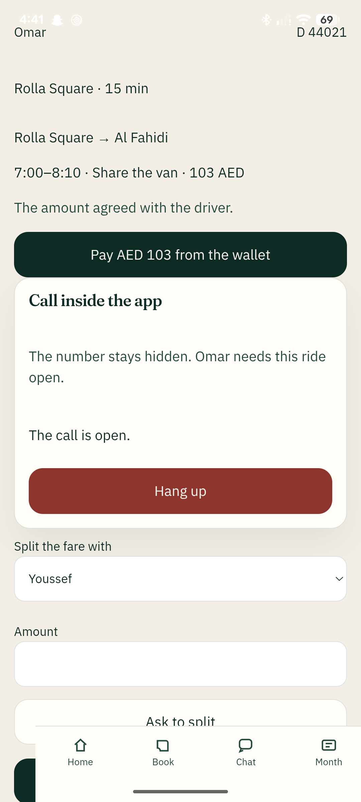<br><sub>Passenger still in the call</sub></td>
    <td width="33%" align="center">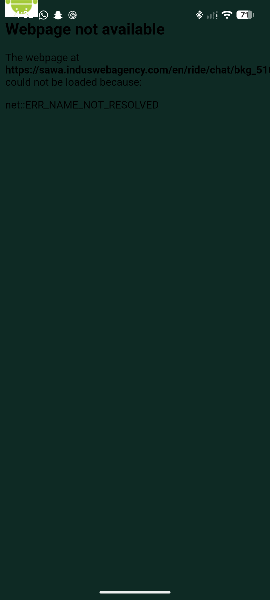<br><sub>Page failed inside the app</sub></td>
  </tr>
</table>

## Licence

All rights reserved. Demonstration software. Not legal advice.
